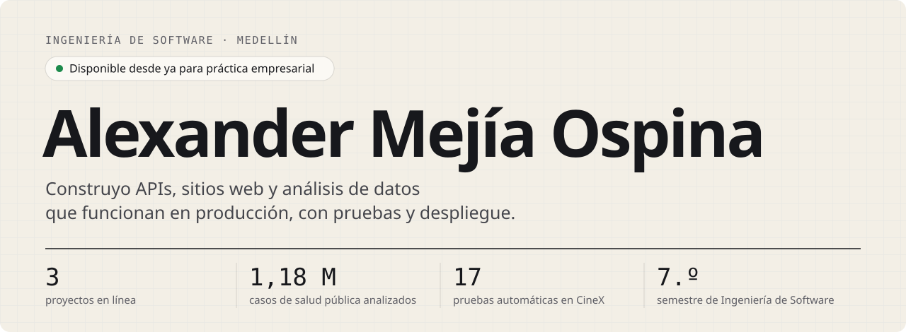

<a href="https://alexanderm-code.github.io/">
  <picture>
    <source media="(prefers-color-scheme: dark)" srcset="./assets/encabezado-oscuro.svg" />
    <source media="(prefers-color-scheme: light)" srcset="./assets/encabezado-claro.svg" />
    
  </picture>
</a>

  
  
  
  

**Estado del sistema**, consultado en vivo cada vez que abres esta página:

 

<code>01 / PROYECTOS</code>

## Hechos para usarse.

<table>
  <tr>
    <td width="50%" valign="top">
      
      
 <code>Proyecto personal · 2026</code>

      <h3>Observatorio de Salud Pública de Antioquia</h3>
      
Pipeline de datos, API y página pública sobre <b>1,18 millones</b> de casos notificados al SIVIGILA en Antioquia entre 2007 y 2022.

      <ul>
        <li>ETL en Python y Pandas desde datos abiertos, con limpieza y validación.</li>
        <li>Modelo estrella en MySQL y análisis con SQL (CTE y funciones de ventana).</li>
        <li>GitHub Actions corre las pruebas y actualiza los datos cada mes.</li>
      </ul>
      
<a href="https://alexanderm-code.github.io/observatorio-salud-antioquia/"><b>Ver observatorio</b></a> · <a href="https://github.com/AlexanderM-Code/observatorio-salud-antioquia">Código</a>

      
<code>Python</code> <code>pandas</code> <code>SQL</code> <code>MySQL</code> <code>FastAPI</code> <code>pytest</code> <code>Docker</code> <code>GitHub Actions</code>

    </td>
    <td width="50%" valign="top">
      
      
 <code>Equipo 2025 · v2.0 individual 2026</code>

      <h3>CineX</h3>
      
Sistema de gestión de cine: cartelera con películas reales de TMDB, salas, funciones, venta de sillas, confitería, usuarios y reservas.

      <ul>
        <li>API REST en Java 21 con Spring Boot y MySQL, con reglas de negocio y errores en JSON (400, 404, 409).</li>
        <li>17 pruebas con JUnit y Mockito, colección de Postman de 26 solicitudes y CI.</li>
        <li>Desplegada gratis: Render, Aiven y GitHub Pages.</li>
      </ul>
      
<a href="https://alexanderm-code.github.io/CineX---Proyecto-Final/"><b>Ver sitio</b></a> · <a href="https://cinex-api-lt2q.onrender.com/swagger-ui/index.html">Probar la API (Swagger)</a> · <a href="https://github.com/AlexanderM-Code/CineX---Proyecto-Final">Código</a>

      
<code>Java 21</code> <code>Spring Boot</code> <code>MySQL</code> <code>JUnit</code> <code>Postman</code> <code>Swagger</code> <code>Docker</code> <code>GitHub Actions</code>

    </td>
  </tr>
  <tr>
    <td width="50%" valign="top">
      
      
 <code>App móvil · Equipo · 2026</code>

      <h3>Numi</h3>
      
App educativa que funciona sin internet, con un asistente de IA que corre en el propio celular, para niños de zonas rurales de Medellín.

      
<b>Mi rol:</b> la arquitectura de la app, la lógica y las pantallas de Ciencias Naturales, el RAG offline del asistente y el diseño responsive.

      
<a href="https://github.com/geminitodo5-sketch/app-educativa-medellin">Código</a>

      
<code>Flutter</code> <code>Dart</code> <code>Riverpod</code> <code>SQLite</code> <code>Gemma 2B</code> <code>FastAPI</code> <code>Firebase</code>

    </td>
    <td width="50%" valign="top">
      
      
 <code>Web · Equipo · 2026</code>

      <h3>Casa Rendón</h3>
      
El sitio de una familia que hace café y vino artesanal en Andes, Antioquia.

      
<b>Mi rol:</b> diseño y desarrollo del sitio: componentes en React y reservas de visita por WhatsApp.

      
<a href="https://casarendon.com"><b>Visitar el sitio</b></a> · <a href="https://github.com/AlexanderM-Code/Entre-sorbos---Casa-Rendon">Código</a>

      
<code>React</code> <code>JavaScript</code> <code>HTML</code> <code>CSS</code>

    </td>
  </tr>
</table>

**También:** [Datos con Python](https://alexanderm-code.github.io/#proyectos) (regresión lineal, logística y ANOVA en el curso de Analítica de Datos) · [Sistema de eventos académicos](https://github.com/AlexanderM-Code/sistema-eventos-academicos) (API en Spring Boot aplicando POO).

 

<code>02 / HABILIDADES</code>

## Lo que he usado, y dónde.

**Lo he usado en proyectos publicados**

  
  
  
  
  
  
  
  
  
  
  
  
  
  
  
  
  
  

**Lo he usado en proyectos académicos o en equipo**

  
  
  
  
  
  
  
  
  
  
  
  
  

**Aprendiendo ahora:** Diplomado en Programación en Java (Politécnico de Colombia) · análisis de datos con Python.

 

<code>03 / CÓMO TRABAJO</code>

## Hábitos que se pueden comprobar.

| | |
| :-- | :-- |
| **Pruebo lo que construyo** | 17 pruebas con JUnit y Mockito en [CineX](https://github.com/AlexanderM-Code/CineX---Proyecto-Final/tree/main/CineX-Backend/cineX_spring_boot/demo/src/test) y pruebas con pytest en el [Observatorio](https://github.com/AlexanderM-Code/observatorio-salud-antioquia/tree/main/tests). |
| **Automatizo** | GitHub Actions corre las pruebas de [CineX](https://github.com/AlexanderM-Code/CineX---Proyecto-Final/actions) en cada push y [actualiza los datos del Observatorio](https://github.com/AlexanderM-Code/observatorio-salud-antioquia/actions) cada mes. |
| **Documento** | La API de CineX está documentada con [Swagger](https://cinex-api-lt2q.onrender.com/swagger-ui/index.html) y cada repositorio tiene un README que explica cómo correrlo. |
| **Trabajo en equipo con Git** | En CineX armé el repositorio y revisé e integré los [pull requests](https://github.com/AlexanderM-Code/CineX---Proyecto-Final/pulls?q=is%3Apr) de mis compañeros. |

 

<code>04 / ACTIVIDAD</code>

<picture>
  <source media="(prefers-color-scheme: dark)" srcset="https://raw.githubusercontent.com/AlexanderM-Code/AlexanderM-Code/output/github-contribution-grid-snake-dark.svg" />
  <source media="(prefers-color-scheme: light)" srcset="https://raw.githubusercontent.com/AlexanderM-Code/AlexanderM-Code/output/github-contribution-grid-snake.svg" />
  
</picture>

 

<code>05 / CONTACTO</code>

## ¿Tu equipo necesita un practicante? Hablemos.

Busco mi práctica empresarial en **desarrollo de software o análisis de datos**, disponible desde ya. Escríbeme a **[alexmejia0112@gmail.com](mailto:alexmejia0112@gmail.com)**.

[Portafolio](https://alexanderm-code.github.io/) · [LinkedIn](https://www.linkedin.com/in/alexander-mejia-ospina) · [Hoja de vida (español)](https://alexanderm-code.github.io/cv/CV_Alexander_Mejia_Ospina.pdf) · [Resume (English)](https://alexanderm-code.github.io/cv/Resume_Alexander_Mejia_Ospina_EN.pdf)

<code>Medellín, Colombia · Última actualización: octubre de 2026</code>
