<a href="https://alexanderm-code.github.io/"><picture><source media="(max-width: 700px)" srcset="assets/readme/movil/portada.svg"></picture></a>

  
  
  
  
  

<a href="https://alexanderm-code.github.io/cv/Resume_Alexander_Mejia_Ospina_EN.pdf">Resume in English (PDF)</a>

Estudiante de Ingeniería de Software (VII semestre) en la Universidad Cooperativa de Colombia, Medellín. Construyo **APIs con Java y Spring Boot**, **pipelines y análisis de datos con Python y SQL** y **sitios web con React**, con pruebas automáticas y desplegados en producción. Busco mi **práctica empresarial en desarrollo de software o análisis de datos**, disponible desde ya.

  <a href="https://alexanderm-code.github.io/observatorio-salud-antioquia/"><picture><source media="(max-width: 700px)" srcset="assets/readme/movil/proyecto-observatorio.svg"></picture></a>
  <a href="https://cinex-api-lt2q.onrender.com/swagger-ui/index.html"><picture><source media="(max-width: 700px)" srcset="assets/readme/movil/proyecto-cinex.svg"></picture></a>
  <a href="https://alexanderm-code.github.io/#proyectos"><picture><source media="(max-width: 700px)" srcset="assets/readme/movil/proyecto-numi.svg"></picture></a>
  <a href="https://casarendon.com"><picture><source media="(max-width: 700px)" srcset="assets/readme/movil/proyecto-casa-rendon.svg"></picture></a>

  Código: <a href="https://github.com/AlexanderM-Code/observatorio-salud-antioquia">Observatorio</a> ·
  <a href="https://github.com/AlexanderM-Code/CineX---Proyecto-Final">CineX</a> ·
  <a href="https://github.com/geminitodo5-sketch/app-educativa-medellin">Numi</a> ·
  <a href="https://github.com/AlexanderM-Code/Entre-sorbos---Casa-Rendon">Casa Rendón</a> ·
  <a href="https://github.com/AlexanderM-Code/sistema-eventos-academicos">Eventos académicos</a>
   Capturas, video y mi rol en cada proyecto en el <a href="https://alexanderm-code.github.io/">portafolio</a>.

<picture><source media="(max-width: 700px)" srcset="assets/readme/movil/trayectoria.svg"></picture>

<picture><source media="(max-width: 700px)" srcset="assets/readme/movil/stack.svg"></picture>

  Credenciales:
  <a href="https://www.skills.google/public_profiles/05106f72-2ef7-404d-96e6-e24611f5a363/badges/23257863">Cloud Load Balancing</a> ·
  <a href="https://www.skills.google/public_profiles/05106f72-2ef7-404d-96e6-e24611f5a363/badges/23629586">App Dev Environment</a> ·
  <a href="https://www.skills.google/public_profiles/05106f72-2ef7-404d-96e6-e24611f5a363">Computing Foundations</a> ·
  <a href="https://www.credly.com/badges/628cb654-0527-4793-85cb-10bc22ab2da6/public_url">C++ Essentials 1</a>

<picture><source media="(max-width: 700px)" srcset="assets/readme/movil/contribuciones.svg"></picture>
<picture>
  <source media="(prefers-color-scheme: dark)" srcset="https://raw.githubusercontent.com/AlexanderM-Code/AlexanderM-Code/output/github-contribution-grid-snake-dark.svg">
  <source media="(prefers-color-scheme: light)" srcset="https://raw.githubusercontent.com/AlexanderM-Code/AlexanderM-Code/output/github-contribution-grid-snake.svg">
  
</picture>

<a href="mailto:alexmejia0112@gmail.com"><picture><source media="(max-width: 700px)" srcset="assets/readme/movil/cierre.svg"></picture></a>
